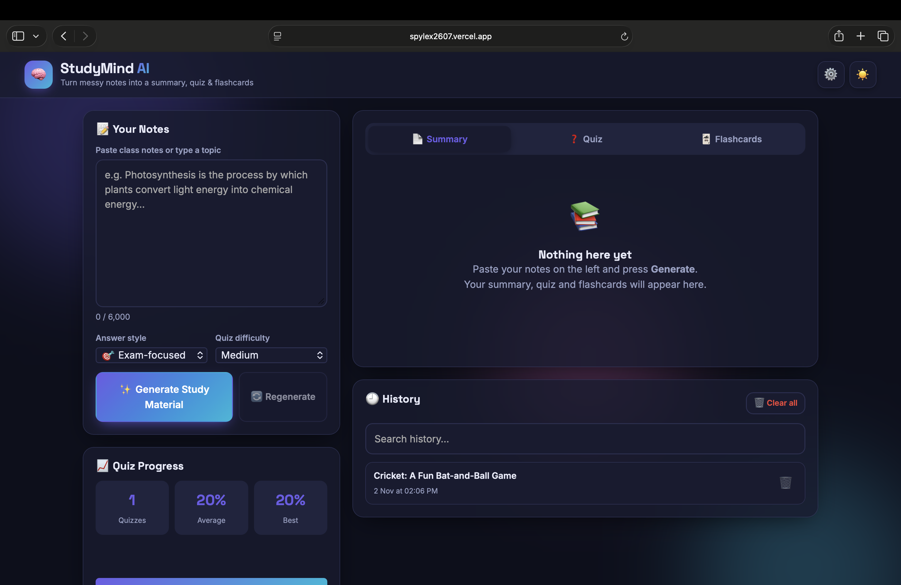

# 🧠 StudyMind AI – AI Study Assistant

🚀 **Live Demo:** [https://spylex2607.vercel.app](https://spylex2607.vercel.app)

Paste your class notes (or just type a topic) and StudyMind AI turns them into:

- 📄 A **summary** with key points
- ❓ A **5-question quiz** with instant right/wrong feedback and a final score
- 🃏 **Flashcards** you can flip and mark as known

It runs entirely in your browser (plain HTML, CSS and JavaScript – no build step, no backend).



<!-- TODO: Take a screenshot of your running app and save it as screenshot.png -->

## ✨ Features

### Required

- Notes text area, Generate button, and a Settings section for your own API key
- `POST` request with `fetch()` + `async / await`
- Summary, Quiz and Flashcards in separate tabs
- Loading spinner; the Generate button is disabled while a request runs
- History saved in `localStorage` (click to reopen, delete one, or clear all)
- Copy to clipboard and Download as `.txt` for the summary
- Error handling for:
  - Missing API key
  - Empty input
  - Network failure
  - 401/403 (bad key)
  - 404
  - 429 (rate limit)
  - 5xx server errors
  - Request timeout
  - Invalid or malformed AI reply
- AI reply parsed with `JSON.parse()` inside `try / catch` and **validated** (summary, quiz and flashcards must exist and be well-formed)

### Extra

- 🌙 Dark / Light mode that is remembered
- 🎯 Answer style: Exam-focused, Explain like I'm 10, Detailed
- 🔊 Read the summary aloud (Speech Synthesis)
- 🔄 Flip animation on flashcards + Known / Not yet buttons with a counter
- 📈 Quiz score tracking with average, best score and a small bar chart
- 🔍 Search inside history, and a 🔄 Regenerate button
- 🔢 Character counter with a long-text warning
- 🎚️ Quiz difficulty selector (easy / medium / hard)

## 🔑 How to Get a Free API Key

You can use either provider. Both offer a free tier, subject to their current limits.

### Google Gemini

1. Go to [Google AI Studio](https://aistudio.google.com/app/apikey).
2. Sign in with your Google account.
3. Click **Create API key**.
4. Copy the key and save it in the app's Settings.

### Groq

1. Go to [Groq Console](https://console.groq.com/keys).
2. Sign up or sign in.
3. Click **Create API Key**.
4. Copy the key and save it in the app's Settings.

## ▶️ How to Use the App

1. Open the [StudyMind AI Live Demo](https://spylex2607.vercel.app) or open `index.html` locally.
2. Click the ⚙️ **Settings** button.
3. Choose a provider, paste **your own API key**, and press **Save settings**.
4. Paste your notes into the text area or type a topic, such as *Photosynthesis*.
5. Choose an answer style and quiz difficulty.
6. Click **Generate Study Material**.
7. Explore the **Summary**, **Quiz**, and **Flashcards** tabs.
8. Revisit previous results in **History**.

> **Shortcut:** Press `Ctrl + Enter` or `Cmd + Enter` inside the notes box to generate study material.

## 🔒 API Key Safety

- Your API key is not hardcoded into the source code or committed to this repository.
- Each visitor supplies their own API key.
- The key is stored in that visitor's browser using `localStorage` and sent to the selected AI provider when making requests.
- Never commit API keys to GitHub.
- Before pushing changes, check your Git history for accidentally committed keys:

```bash
git log -p | grep -iE "AIza|gsk_"
```

**Important:** Browser-side API keys can be inspected by the user or exposed through browser developer tools and network requests. Use your own key only on trusted deployments, and monitor your provider's usage limits.

## 📁 Project Structure

```text
ai-study-assistant/
├── index.html   # Page structure
├── style.css    # Design, themes, responsive layout, animations
├── script.js    # API calls, parsing, rendering, and history
└── README.md    # Project documentation
```

## 🧩 How the Fetch Request Works (For Your Viva)

Example of a request to the Google Gemini API:

```javascript
fetch(url, {
  method: "POST", // Sends data to the API
  headers: {
    "Content-Type": "application/json",
    "x-goog-api-key": key // Gemini authentication
  },
  body: JSON.stringify({
    contents: [...]
  })
});
```

### Request Workflow

1. `buildPrompt()` creates the instructions and asks the AI to return **JSON only** in a fixed structure.
2. `callAI()` sends the request using `fetch()`. Network failures are handled, and `response.ok` is used to detect HTTP errors such as 401 and 429.
3. `response.json()` converts the API response into a JavaScript object. The provider-specific `extractText()` function extracts the AI-generated text.
4. `parseAIResponse()` uses `JSON.parse()` inside `try / catch` and validates the summary, quiz, and flashcards.
5. `renderAll()` displays the generated study material using DOM methods such as `createElement()` and `textContent`.

## 🚀 Deployment

### Vercel

**Live deployment:** [https://spylex2607.vercel.app](https://spylex2607.vercel.app)

To deploy updates:

1. Push your latest code to your GitHub repository.
2. Open [Vercel](https://vercel.com/).
3. Import your GitHub repository if you haven't already.
4. Configure the project and deploy.
5. Future pushes to the connected branch can trigger automatic deployments.

### Netlify

You can also deploy the project using [Netlify Drop](https://app.netlify.com/drop) by dragging and dropping your project folder.

## 🛠️ Tech Stack

- **HTML5** – Page structure
- **CSS3** – Styling, Grid, Flexbox, custom properties, animations, and 3D transforms
- **Vanilla JavaScript (ES6+)** – Application logic and interactivity
- **Fetch API** – Communicating with AI providers
- **localStorage** – Saving settings, history, and preferences
- **Web Speech API** – Reading summaries aloud

## 👨‍💻 Author

**Laxman Choudhary**

- GitHub: [@Laxman26spy](https://github.com/Laxman26spy)
- Project: [StudyMind AI – Live Demo](https://spylex2607.vercel.app)

---

⭐ If you find StudyMind AI useful, consider giving the repository a star!
